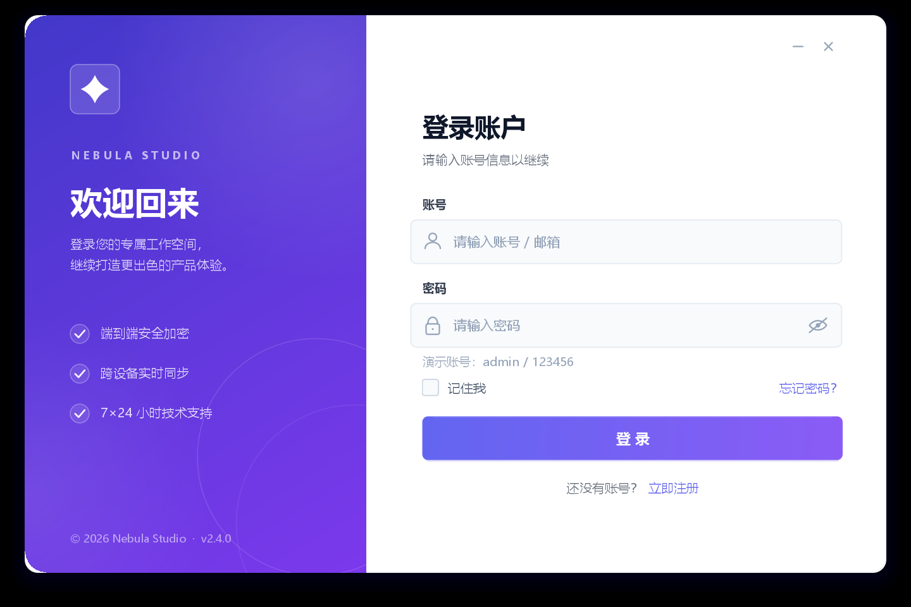

# Nebula Studio 登录界面（Java Swing）

纯 Java2D 手绘的现代化登录窗口，无第三方依赖。



## 运行

环境：JDK 8+（已在本机 JDK 21 验证）

在 IntelliJ IDEA 中打开 `day08_inner_lambda` 模块，直接运行 `com.xingren.guidemo01.LoginFrame` 的 `main` 方法，
或在模块根目录执行：

```bat
cd D:\code\personal_demos\java_basic_practice\day08_inner_lambda
javac -encoding UTF-8 -d out src\com\xingren\gui\LoginFrame.java
java -cp out com.xingren.guidemo01.LoginFrame
```

- 演示账号：`admin` / `123456`
- 账号或密码为空会显示校验提示，输错会显示错误提示
- `Enter` 提交登录，`Esc` 关闭窗口
- 按住品牌区或表单空白处可拖动窗口

## 界面特性

- 无边框透明窗口 + 圆角卡片 + 多层模拟柔和投影（系统不支持逐像素透明时自动回退）
- 左侧渐变品牌区，带缓慢漂移的光斑装饰
- 自绘圆角输入框：悬停/聚焦光晕、线性图标、占位文本、密码显隐
- 渐变登录按钮：悬停渐变动画、按压态、登录中加载转圈
- 自定义复选框、文字链接、最小化/关闭按钮
- 启动淡入动画

## 接入真实登录

找到 `LoginFrame.java` 中的 `FormPanel#doLogin()`，把模拟校验替换成你的认证逻辑。
如果是数据库或 HTTP 请求，建议使用 `SwingWorker` 在后台执行，完成后再回到 EDT 更新
`showStatus(...)` 或打开主界面：

```java
// 成功后
showStatus("登录成功，正在进入系统…", Palette.SUCCESS);
// new MainFrame().setVisible(true);
// dispose();
```

常用定制位置：

| 内容 | 位置 |
| --- | --- |
| 主题色 | `Palette` 内部类 |
| 字体 | `Typography`（自动挑选微软雅黑 / PingFang / Noto） |
| 窗口尺寸、圆角、品牌区宽度 | `LoginFrame` 顶部常量 |
| 品牌文案与功能列表 | `BrandPanel#paintCopy` |
| 校验规则 | `FormPanel#doLogin` |

“记住我 / 忘记密码 / 立即注册”目前是纯 UI 占位，可按需绑定事件。

## 文件说明

- `LoginFrame.java`：全部源码（窗口、自绘组件、动效、交互）
- `screenshot.png`：界面预览
- `dev-preview/`：开发阶段用于自动化截图校验的临时文件，可直接忽略或删除
